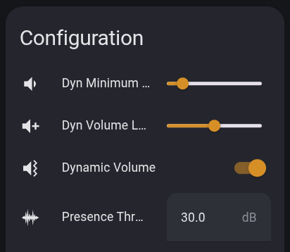
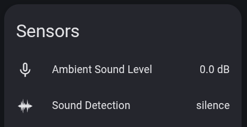

<a name="readme-top"></a>
[](#) [](https://github.com/fixtse)

<a href='https://ko-fi.com/M4M6P9A5P' target='_blank'></a>

# Home Assistant Voice SoundSense

## Table of Contents
- [Features](#features)
- [Installation](#installation)
  - [Method 1: Using ESPHome Packages](#method-1-using-esphome-packages-recommended)
  - [Method 2: Manual Installation](#method-2-manual-installation)
- [Microphone and player compatibility](#microphone-and-player-compatibility)
- [Validation](#validation)
- [Technical Details](#technical-details)

## Features

<div align="center">
  <table>
    <tr>
      <td></td>
      <td></td>
    </tr>
  </table>
</div>

The SoundSense package extends the Dynamic Volume Capabilities with Sound detection features.
The system is designed to be resource-efficient and responsive, providing a natural listening experience by keeping your device's volume at an optimal level for the current environment.

### Sound Detection States

SoundSense analyzes the ambient sound and classifies it into five different states:

- **Silence**: Prolonged period (>15s) of very low ambient noise
- **Quieting**: Recent transition to low ambient noise
- **Active**: Normal ambient sound activity
- **Noise**: Sudden spikes in sound levels
- **Presence**: Sustained elevated sound levels, indicating ongoing activity or presence

### Configurable Controls

SoundSense provides three configurable controls:

1. **Dynamic Minimum Volume** (0-100%): Sets the base volume level when ambient noise is minimal
2. **Dynamic Volume Level** (0-10): Controls how aggressively volume scales up with ambient noise
3. **Presence Threshold** (0-100 dB): Sets the sound level that triggers "presence" detection

### Optimized Sound Processing

- **Real-time audio processing** using microphone `on_data` triggers for maximum efficiency
- **Efficient sound level calculation** using logarithmic dB conversion
- **Smart hysteresis** to prevent rapid volume fluctuations
- Volume adjustments occur **only when necessary**, with smooth transitions
- Processing **pauses during media playback** to avoid feedback loops
- **Microphone trigger approach** processes audio data as it arrives rather than polling

<p align="right">(<a href="#readme-top">back to top</a>)</p>

## Installation

### Method 1: Using ESPHome Packages (Recommended)

If you want to use the SoundSense package, add the following to your configuration:

```yaml
packages:
  SoundSense: github://fixtse/ha-voice-sound-sense/sound_sense.yaml
```

Then you need to add the microphone trigger to call the sound processing script. Add this to your microphone configuration:

```yaml
microphone:
  - platform: i2s_audio  # or your microphone platform
    id: i2s_mics
    # ... your existing microphone config ...
    on_data:
      - script.execute:
          id: process_audio_data
          audio_data: !lambda return x;
```

Example integration with your existing configuration:

```yaml
substitutions:
  name: your-ha-voice-device-name  # Replace with your device name
  friendly_name: Your HA Voice     # Replace with your friendly name

packages:
  # Official ESPHome Home Assistant Voice PE package
  Voice PE: github://esphome/home-assistant-voice-pe/home-assistant-voice.yaml
  # SoundSense package
  SoundSense: github://fixtse/ha-voice-sound-sense/sound_sense.yaml

# Your existing API configuration
api:
  encryption:
    key: YOUR_API_KEY

# Your existing WiFi configuration  
wifi:
  ssid: !secret wifi_ssid
  password: !secret wifi_password

# Add microphone trigger for sound processing
microphone:
  - platform: i2s_audio
    id: i2s_mics
    # ... your existing microphone configuration ...
    on_data:
      - script.execute:
          id: process_audio_data
          audio_data: !lambda return x;
```

### Method 2: Manual Installation

If you prefer not to use packages, you can copy the full configuration from the [sound_sense.yaml](sound_sense.yaml) file and add it to your existing ESPHome configuration.

**Important**: You must also add the microphone trigger to your microphone configuration:

```yaml
microphone:
  - platform: i2s_audio  # or your microphone platform
    # ... your existing microphone config ...
    on_data:
      - script.execute:
          id: process_audio_data
          audio_data: !lambda return x;
```

<p align="right">(<a href="#readme-top">back to top</a>)</p>

## Microphone and player compatibility

SoundSense accepts signed, little-endian PCM delivered by an ESPHome microphone
`on_data` callback. It supports 16-bit PCM (including PDM), packed 24-bit PCM,
and 32-bit PCM, with mono or interleaved multichannel input. It does not decode
compressed audio or unsigned PCM. Choose the **callback data format**, which can
differ from the I2S bus slot size: ESPHome's PDM driver delivers 16-bit samples
even when its configuration specifies a 32-bit slot.

Existing configurations keep their defaults: `external_media_player`, 32-bit
mono input, and one out of every four frames measured. A `mww` component is no
longer required. Existing entity and script IDs remain unchanged.

| Substitution | Default | Meaning |
| --- | --- | --- |
| `sound_sense_player_id` | `external_media_player` | ESPHome media-player ID; works with speaker and I2S media players |
| `sound_sense_sample_bits` | `32` | Callback sample/container width: `16`, `24`, or `32` |
| `sound_sense_channels` | `1` | Number of interleaved channels in each frame |
| `sound_sense_channel` | `0` | Zero-based channel to measure |
| `sound_sense_sample_stride` | `4` | Measure every Nth frame; positive integer |
| `sound_sense_capture_allowed` | `true` | C++ boolean expression gating measurement and automatic volume changes |
| `sound_sense_player_idle` | Selected player's state is idle | C++ boolean expression preventing playback feedback |
| `sound_sense_set_volume` | Selected player's media-player volume call | C++ statement applying the float parameter `volume` (0–1) |

Override substitutions in the consuming root YAML. Invalid sample widths,
channel selections and strides fail compilation with a diagnostic. Incomplete
trailing frames are ignored. Samples are decoded without aligned pointer casts;
negative full-scale values are handled without signed overflow. All supported
widths are normalized to the existing SoundSense level scale, preserving its
thresholds. These levels are relative estimates, **not calibrated dB SPL**.

### PDM microphone and speaker media player

For a panel whose IDs are `panel_microphone` and `panel_media_player`:

```yaml
substitutions:
  sound_sense_player_id: panel_media_player
  sound_sense_sample_bits: "16"
  sound_sense_capture_allowed: "!id(microphone_muted).state"

packages:
  SoundSense: github://fixtse/ha-voice-sound-sense/sound_sense.yaml

microphone:
  - id: !extend panel_microphone
    on_data:
      - script.execute:
          id: process_audio_data
          audio_data: !lambda return x;
```

This extends an existing microphone; retain its board-specific pins, PDM setting
and sample rate. `microphone_muted` must exist if using that optional gate. Omit
or replace the gate for devices with another mute mechanism.

### Stereo I2S microphone

Select the right channel of a 32-bit stereo callback, with any media-player ID:

```yaml
substitutions:
  sound_sense_player_id: living_room_player
  sound_sense_sample_bits: "32"
  sound_sense_channels: "2"
  sound_sense_channel: "1"
```

For packed 24-bit callbacks, use `sound_sense_sample_bits: "24"`. For 24 valid
bits stored left-aligned in a 32-bit container, use `"32"`. Right-aligned valid
bits require conversion before calling `process_audio_data`. The package does
not infer channel count or sample width from byte-buffer length.

### Speaker-only output

A raw ESPHome `speaker` has no media-player state or `make_call()` API. Override
both output hooks; no media player or `mww` is then needed:

```yaml
substitutions:
  sound_sense_sample_bits: "16"
  sound_sense_player_idle: "!id(panel_speaker).is_running()"
  sound_sense_set_volume: "id(panel_speaker).set_volume(volume);"
```

The `panel_speaker` ID must refer to an existing ESPHome speaker. For an output
that remains running while idle, supply your own playback-active boolean instead
of `is_running()`. Additional busy/mute checks can be combined in
`sound_sense_capture_allowed`, for example
`!id(microphone_muted).state && !id(assist).is_running()`.

### Microphone lifetime and playback

The package processes callbacks; it does not start the microphone or own its
lifetime. An enabled voice/wake-word pipeline or your own balanced
`id(your_microphone).start()` / `id(your_microphone).stop()` calls must supply audio. Honor
the device's mute/privacy control when starting capture. Disabling measurement
through the gate does not stop any microphone listeners by itself.

Measurement and automatic volume changes pause when either gate is false.
Disabling Dynamic Volume retains the existing behavior of resetting the output
to Dyn Minimum Volume. The gates do not suppress that explicit switch action.
When no callbacks arrive or processing is gated, the existing sensor retains its
last value; this is not a live measurement or proof of silence.

## Validation

Run `scripts/validate.sh` on a build host with Docker. The pinned container
provides Python and the C++ toolchain. It checks actual
PCM processing across formats/channels (including extrema and partial frames),
then validates and compiles ESPHome fixtures for a PDM/speaker media player,
a stereo I2S microphone with a renamed player, and a speaker-only output.
The fixtures use ESPHome 2026.11.0 and contain no network credentials. Build
validation does not establish microphone quality, volume calibration or acoustic
behavior on hardware.

## Technical Details

SoundSense uses an advanced algorithm to:

1. **Trigger on audio data**: Uses ESPHome's `microphone.on_data` trigger for real-time processing
2. **Calculate sound levels**: Convert audio samples to decibel measurements using logarithmic lookup
3. **State detection**: Apply logic based on configurable thresholds for presence detection
4. **Dynamic volume**: Calculate volume adjustments based on ambient conditions
5. **Smooth transitions**: Apply hysteresis and smoothing for stable volume changes

<p align="right">(<a href="#readme-top">back to top</a>)</p>

## Troubleshooting

### Common Issues

**Q: The Ambient Sound Level sensor shows 0 or doesn't update**
- Ensure you've added the `on_data` trigger to your microphone configuration
- Verify the microphone is working in ESPHome logs
- Set `sound_sense_sample_bits` and channel substitutions to the callback PCM format
- Check the capture/player-idle gates and ensure something starts microphone capture

**Q: Dynamic volume isn't working**
- Make sure the Dynamic Volume switch is turned on in Home Assistant


**Q: Sound detection states don't change**
- Ensure the microphone is picking up audio (check Ambient Sound Level sensor)
- Adjust the Presence Threshold setting in Home Assistant


<p align="right">(<a href="#readme-top">back to top</a>)</p>

## License

Shield: [![CC BY-NC-SA 4.0][cc-by-nc-sa-shield]][cc-by-nc-sa]

This work is licensed under a
[Creative Commons Attribution-NonCommercial-ShareAlike 4.0 International License][cc-by-nc-sa].

[![CC BY-NC-SA 4.0][cc-by-nc-sa-image]][cc-by-nc-sa]

[cc-by-nc-sa]: http://creativecommons.org/licenses/by-nc-sa/4.0/
[cc-by-nc-sa-image]: https://licensebuttons.net/l/by-nc-sa/4.0/88x31.png
[cc-by-nc-sa-shield]: https://img.shields.io/badge/License-CC%20BY--NC--SA%204.0-lightgrey.svg

<p align="right">(<a href="#readme-top">back to top</a>)</p>
